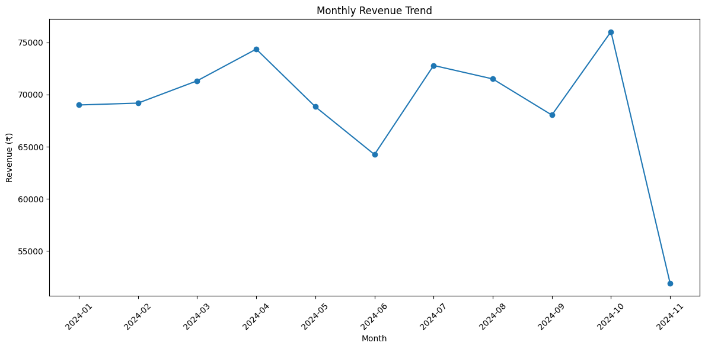
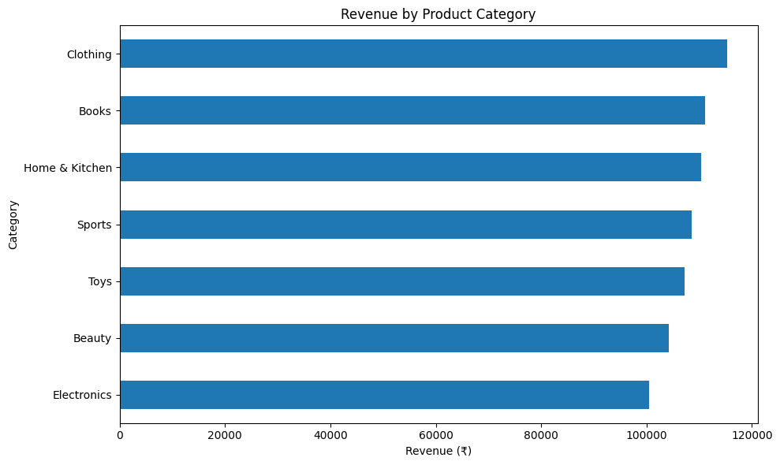
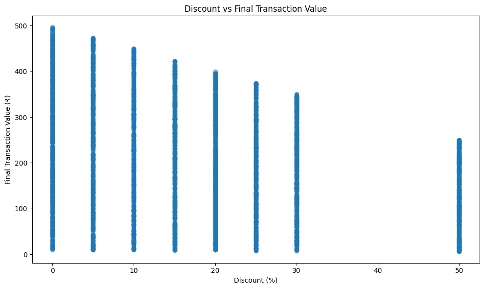
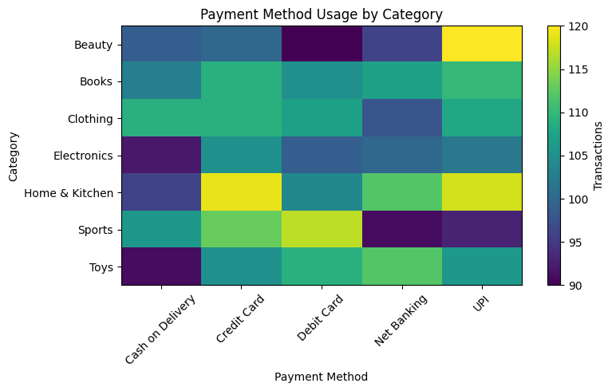

# E-commerce Sales & Discount Analysis

An end-to-end analysis of 3,660 e-commerce transactions (Jan–Nov 2024) to understand what drives revenue and whether discounting, payment method or purchase timing change customer behaviour. **Most factors turned out to be statistically indistinguishable from random.** The one real pattern is that discounts give away about ₹1.75 lakh (18.8% of list value) without attracting bigger purchases or more orders.

**Tools:** MySQL · Python (pandas, matplotlib, SciPy)

---

## Charts

| Monthly revenue | Revenue by category |
|---|---|
|  |  |

| Discount vs final transaction value | Payment method usage by category |
|---|---|
|  |  |

---

## Business question

A marketing and payments manager wants to know: which categories and payment methods matter, do discounts pay off, and does purchase timing (weekday vs weekend) change spending? The answers should be backed by statistical tests, not guesses.

## Dataset

| | |
|---|---|
| Source | E-commerce transactions dataset (Kaggle) |
| Size | 3,660 transactions, 8 columns |
| Period | 1 Jan 2024 – 21 Nov 2024 |
| Currency | Indian Rupees (₹) |
| Coverage | 7 categories, 5 payment methods, discounts of 0–50% |
| Quality | No nulls, no duplicates, final price matches `price × (1 − discount)` in every row |

Columns: `User_ID`, `Product_ID`, `Category`, `Price (Rs.)`, `Discount (%)`, `Final_Price(Rs.)`, `Payment_Method`, `Purchase_Date`.

## Approach

**1. MySQL: validation and business queries** (`sql/ecommerce_analysis.sql`)
- Null, duplicate, invalid-discount, invalid-price and price-calculation checks.
- Revenue, transaction counts and average order value by category, payment method and month.
- Discount groups (No / Low / Medium / Very High), category × discount cross-analysis and total discount given.
- A CTE with `RANK()` to rank categories by revenue, and `SUM() OVER()` for each category's revenue share.
- `STR_TO_DATE` to convert `Purchase_Date`, which is stored as text in DD-MM-YYYY format.

**2. Python: statistical testing** (`python/E_Commerce_Sales_Analysis.ipynb`)
- Repeated the validation checks and converted dates.
- Built features: discount amount, month, day of week, weekend flag.
- Charts for monthly, weekday, category, payment and discount patterns.
- **Chi-square test:** is payment method associated with category?
- **Welch's t-test:** do weekend and weekday transactions differ in value?
- **Correlation:** discount vs final transaction value.

## Key findings

**1. Overall performance:** ₹7.57 lakh revenue from 3,660 transactions. Average order value is ₹206.91 and the average discount is 18.83%.

**2. Categories are close together.** Revenue shares run from 13.3% (Electronics) to 15.2% (Clothing), a narrow spread.

| Category | Transactions | Revenue | Share |
|---|---|---|---|
| Clothing | 531 | ₹1,15,315 | 15.2% |
| Books | 534 | ₹1,11,149 | 14.7% |
| Home & Kitchen | 549 | ₹1,10,328 | 14.6% |
| Sports | 520 | ₹1,08,519 | 14.3% |
| Toys | 523 | ₹1,07,290 | 14.2% |
| Beauty | 505 | ₹1,04,215 | 13.8% |
| Electronics | 498 | ₹1,00,462 | 13.3% |

**3. Payment methods are evenly split.** Credit card (20.8%), UPI (20.7%), debit card (20.0%), net banking (19.6%) and cash on delivery (19.0%) are all within two points of each other, with average order values of ₹204–210.

**4. Statistical tests found no relationships:**

| Test | Question | Result | Conclusion |
|---|---|---|---|
| Chi-square | Does payment method depend on category? | p = 0.9398 | No association |
| Welch's t-test | Weekend vs weekday order value | ₹205.28 vs ₹207.55, p = 0.6089 | No difference |

**5. Discounts reduce order value but do not change who buys.**

| Discount group | Transactions | Avg final value |
|---|---|---|
| No discount | 480 | ₹255.22 |
| Low (5–15%) | 1,417 | ₹231.98 |
| Medium (20–30%) | 1,333 | ₹188.15 |
| Very high (50%) | 430 | ₹128.51 |

- Discount and final value are negatively correlated (r = −0.31), but this is arithmetic. Discount and **list** price are uncorrelated (r = −0.003), so deep discounts are not going to cheaper or pricier products.
- Order counts are about the same at every discount level (412–480 per level), so there is no sign that deeper discounts bring in more orders.
- Total discount given: **₹1,75,292**, or 18.8% of list value.

## Recommendation

- **Test discount effectiveness before spending more on it.** The data shows no volume lift from deeper discounts. Run a controlled test (for example, 0% vs 15% on a category) to see if discounts change order counts.
- **Don't build category-specific or payment-specific campaigns on this data.** Categories and payment methods behave the same.
- **Don't target weekends differently.** Spend per order is the same on weekdays and weekends.

## Data quality notes

- **No repeat customers.** Every `User_ID` and `Product_ID` appears exactly once, so repeat-purchase, loyalty or customer-lifetime analysis isn't possible.
- **November is a partial month.** Data ends 21 Nov 2024, so November's lower revenue (₹51,915) is not a real drop. The monthly trend is otherwise flat at about ₹64,000–76,000.
- **No discounts between 30% and 50%.** Discounts jump from 30% to 50%, so the "High Discount" band (31–45%) is empty. It is kept in the code for completeness.
- **The data looks simulated.** Categories, payment methods and weekdays are almost perfectly balanced, and discount is independent of price. The project demonstrates method and honest reporting rather than a real company's results.
- **Original dataset had no delivery or review fields,** so the project focuses on purchase, payment and discount behaviour.

## Repository structure

```
ecommerce-sales-analysis/
├── README.md
├── images/
│   ├── monthly_revenue.png
│   ├── revenue_by_category.png
│   ├── discount_vs_final_value.png
│   └── payment_vs_category_heatmap.png
├── SQL/
│   └── ecommerce_analysis.sql
├── Python/
│   └── E_Commerce_Sales_Analysis.ipynb
└── Dataset/
    └── ecommerce_dataset_updated.csv
```

## How to reproduce

1. Download the dataset from Kaggle (or use `data/ecommerce_dataset_updated.csv`).
2. **MySQL:** import the CSV into a table named `ecommerce_dataset_updated` and run `sql/ecommerce_analysis.sql`.
3. **Python:** open the notebook in Jupyter or Google Colab, place the CSV in the same folder (update the read path if needed) and run all cells.

## What I'd do next

- Run a discount A/B test to measure real volume lift.
- Add a Power BI or Streamlit dashboard for non-technical stakeholders.
- Repeat the analysis on data with repeat customers to enable cohort and RFM analysis.

## Skills demonstrated

Data validation · SQL aggregation, `CASE` logic, CTEs and window functions · Date handling · pandas feature engineering · Hypothesis testing (chi-square, t-test) and correlation · Reporting null results honestly

## Author

**Mihir Kavde**: Aspiring Data Analyst
[LinkedIn](https://www.linkedin.com/in/MihirKavde/) · [GitHub](https://github.com/MihirKavde) · mihirkavde@gmail.com
